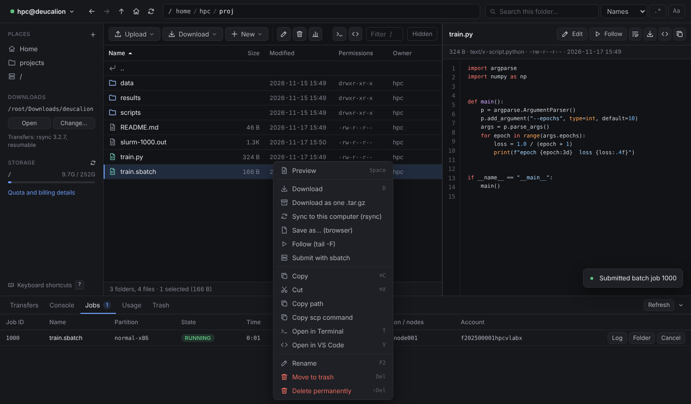

# ssh-fetcher

A local web GUI for browsing, searching, previewing and moving files on a remote machine over SSH. It was built for **Deucalion** and works with any host alias in `~/.ssh/config`.

```bash
./ssh-fetcher              # connects to "deucalion" and opens your browser
./ssh-fetcher search       # any other ~/.ssh/config alias
python3 server.py --host deucalion --port 8765 --download-dir ~/Downloads/deucalion --no-browser
```

You only need Python 3 (standard library only) and the system `ssh`/`scp`/`tar`, so your keys, Keychain and ssh config all keep working. The front-end libraries (highlight.js, marked, DOMPurify) are bundled in `static/vendor`, so the app works on any network.

**Optional: rsync for resumable transfers.** rsync must be installed on both ends. The rsync that ships with macOS (2.6.9, or openrsync on macOS 15) is too old, so install rsync 3.1+ with `brew install rsync`. Deucalion normally has rsync. Without it, everything still works through scp and tar, but transfers cannot be resumed or synced. The sidebar shows which mode is active.

## Screenshots




## Features
- **Navigate like a shell.** Breadcrumbs, an editable path bar (`⌘L`) that accepts `~`, relative paths and `..`, back/forward history, and bookmarks. `alias x='cd …'` lines in your remote `~/.bashrc` become bookmarks automatically.
- **Keyboard driven.** `↑↓` move, `Enter`/`→` open, `⌫`/`←` go to the parent folder, `Space` preview, typing jumps to a matching name, `/` filter, `D` download, `F2` rename, `Del` move to trash, `⇧Del` delete permanently, `⌘C`/`⌘X`/`⌘V` copy/cut/paste, `R` refresh, `T` open in Terminal, `V` open in VS Code, `` ` `` console.
- **Open in Terminal or VS Code.** One click (or `T` / `V`) opens the current remote folder in a new local iTerm2 / Terminal tab over SSH (`ssh -t <host> "cd '<path>' && exec $SHELL -l"`) or in VS Code via Remote-SSH. Also available when right-clicking any folder or file.
- **Search** (recursive, from the current folder) by **name** (`find`) or by **content** (`grep`), with regex and case options. Click a content hit to preview the file scrolled to that line. Double-click a hit to open its folder.
- **Preview.** Text and code with line numbers and syntax highlighting, Markdown, CSV/TSV as tables, images, PDF, audio/video, and a hex dump for binaries. Small text files can be **edited and saved** back.
- **Download to your Mac.** Folders are streamed as one `tar` stream over the existing connection, which is much faster than `scp -r` for many small files. Files use rsync when available (scp otherwise). Files go to `~/Downloads/<host>` by default; you can change this in the sidebar. Progress shows in the Transfers tab, with *Show in Finder*.
- **Resume and sync (rsync).** A failed or cancelled download has a *Resume* button that continues where it stopped (rsync `--partial`). *Sync to Mac* updates an earlier download in place, copying only what changed.
- **Download as one `.tar.gz`** for any selection.
- **Upload to the current remote folder:** use the native macOS picker for files or folders, or drag and drop files onto the window. Uploads use rsync when available, with progress reported by rsync; with scp, the remote size is checked every 5 to 10 s instead of every second, to spare the Lustre metadata servers. You're asked before anything is overwritten.
- **Copy, cut and paste** (`⌘C`, `⌘X`, `⌘V`) between remote folders. It runs `cp -a` or `mv` on the remote host, with no round trip through your Mac, as a cancellable job.
- **Trash with undo.** Delete moves items to `~/.ssh-fetcher-trash` on the remote (a rename, never a copy), with an *Undo* toast and a Trash tab to restore or purge. Items on another filesystem than your home (for example `/projects`) can't be renamed into the trash, so you're asked whether to delete them permanently instead. `Shift+Del` deletes permanently. Deleting `/`, any top-level folder, your home folder or one of its parents is always refused.
- **Safe saving.** Edits are written to a temporary file and renamed into place (atomic), and saving warns you if the file changed on the remote since you opened it.
- **Slurm tab:** your jobs (`squeue --me`) with state, time and reason, auto-refreshing every 15 s. *Cancel* runs `scancel`, *Log* follows the job's output file, *Folder* opens its working directory. Right-click a job script and choose *Submit with sbatch*.
- **Follow a log** (`tail -F`) in the preview: new lines stream in as the file grows.
- **Quota and billing.** The sidebar shows your storage quota (`lfs quota` on Lustre mounts, `df` otherwise). The Usage tab shows the Deucalion `billing` output and, per account, usage per user (`billing -a <account>`); the account suffix tells the partition (`a` = ARM, `x` = x86, `g` = GPU). *Sizes* measures the subfolders of the current folder with `du` and sorts them by size, to find what uses your quota.
- New folder or file, rename, copy path or a ready-made `scp` command.
- A **console** that runs commands in the current folder and streams their output live (`cd` works too). `Ctrl+C` or *Stop* interrupts the command.

## How it works
- The server listens on `127.0.0.1` only. Every API call needs a random per-run token, which is passed in the URL that gets opened and then kept out of the address bar. Image, video and download URLs authenticate with an `HttpOnly`, `SameSite=Strict` cookie instead of the token, so it never appears in URLs. If the port is taken (a second instance), the next free one is used.
- Remote files are treated as untrusted: Markdown is sanitised with DOMPurify, the page runs only its own bundled scripts (Content Security Policy), and raw files are served sandboxed, with HTML and SVG only as downloads.
- Opening a new SSH session on Deucalion takes about 1 s. To avoid that cost, the server keeps one multiplexed connection (`ControlMaster`) plus a small pool of persistent remote Python agents that speak JSON lines. That brings directory listings down to roughly 150 ms.
- Transfers use real `rsync`, `scp` and `tar` processes over the same multiplexed connection. Console commands, log follows and remote copies stream through a separate agent pool, so long-running commands never slow down browsing.
