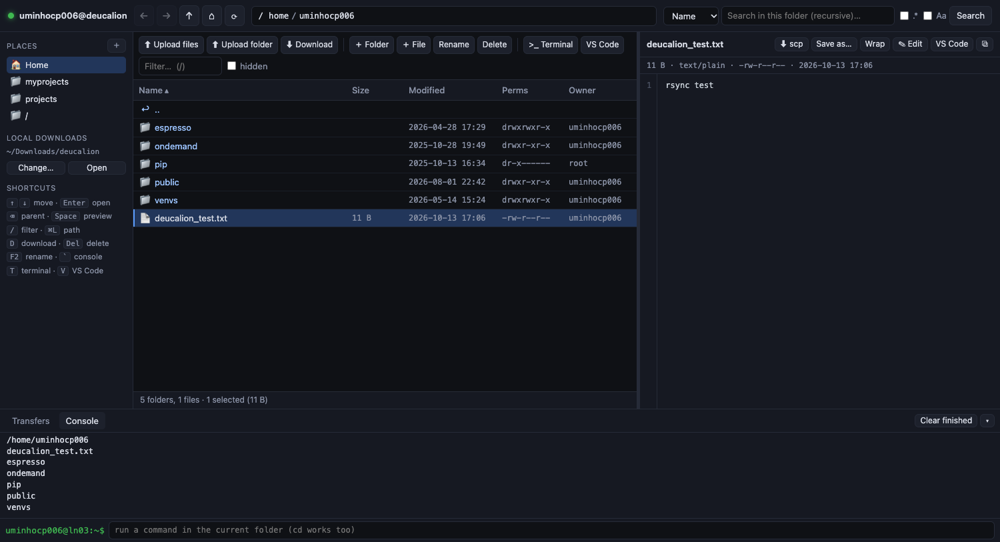
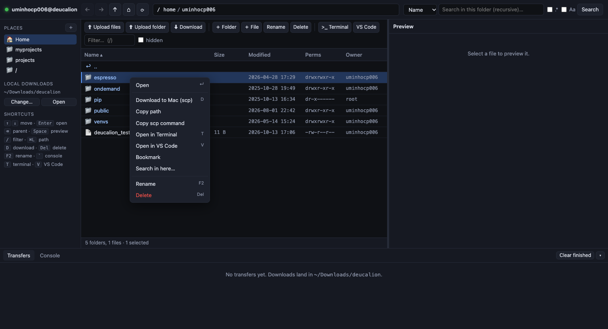

# ssh-fetcher

A local web GUI for browsing, searching, previewing and moving files on a remote machine over SSH. It was built for **Deucalion** and works with any host alias in `~/.ssh/config`.

```bash
./ssh-fetcher              # connects to "deucalion" and opens your browser
./ssh-fetcher search       # any other ~/.ssh/config alias
python3 server.py --host deucalion --port 8765 --download-dir ~/Downloads/deucalion --no-browser
```

You only need Python 3 (standard library only) and the system `ssh`/`scp`, so your keys, Keychain and ssh config all keep working.

## Screenshots





## Features
- **Navigate like a shell.** Breadcrumbs, an editable path bar (`⌘L`) that accepts `~`, relative paths and `..`, back/forward history, and bookmarks. `alias x='cd …'` lines in your remote `~/.bashrc` become bookmarks automatically.
- **Keyboard driven.** `↑↓` move, `Enter`/`→` open, `⌫`/`←` go to the parent folder, `Space` preview, typing jumps to a matching name, `/` filter, `D` download, `F2` rename, `Del` delete, `R` refresh, `T` open in Terminal, `V` open in VS Code, `` ` `` console.
- **Open in Terminal or VS Code.** One click (or `T` / `V`) opens the current remote folder in a new local iTerm2 / Terminal tab over SSH (`ssh -t <host> "cd '<path>' && exec $SHELL -l"`) or in VS Code via Remote-SSH. Also available when right-clicking any folder or file.
- **Search** (recursive, from the current folder) by **name** (`find`) or by **content** (`grep`), with regex and case options. Click a content hit to preview the file scrolled to that line. Double-click a hit to open its folder.
- **Preview.** Text and code with line numbers and syntax highlighting, Markdown, CSV/TSV as tables, images, PDF, audio/video, and a hex dump for binaries. Small text files can be **edited and saved** back.
- **Download to your Mac** with `scp` (`-r` for folders). Files go to `~/Downloads/deucalion` by default; you can change this in the sidebar. Progress shows in the Transfers tab, with *Show in Finder*.
- **Upload to the current remote folder:** use the native macOS picker for files or folders (`scp -r` straight from disk), or drag and drop files onto the window. You're asked before anything is overwritten.
- New folder or file, rename, delete (with confirmation), copy path or a ready-made `scp` command.
- A **console** that runs non-interactive commands in the current folder (`cd` works too).

## How it works
- The server listens on `127.0.0.1` only. Every API call needs a random per-run token, which is passed in the URL that gets opened.
- Opening a new SSH session on Deucalion takes about 1 s. To avoid that cost, the server keeps one multiplexed connection (`ControlMaster`) plus a small pool of persistent remote Python agents that speak JSON lines. That brings directory listings down to roughly 150 ms.
- Transfers use real `scp` processes over the same multiplexed connection.
