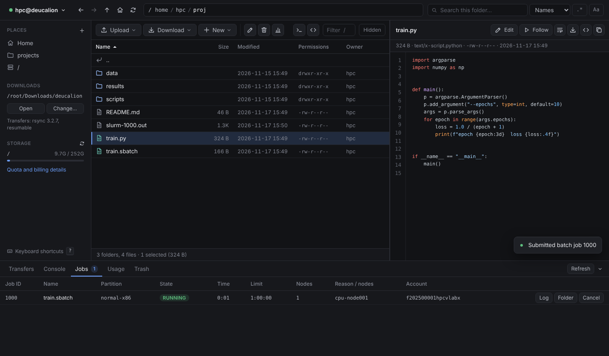

# ssh-fetcher

A local web app for browsing, previewing, editing and moving files on a remote machine over SSH, with Slurm job management built in. It was made for the **Deucalion** supercomputer and works with any host alias in `~/.ssh/config`.



## Quick start

```bash
./ssh-fetcher              # connects to "deucalion" and opens your browser
./ssh-fetcher search       # any other ~/.ssh/config alias
python3 server.py --host deucalion --port 8765 --download-dir ~/Downloads/deucalion --no-browser
```

Requirements: Python 3 (standard library only) and the system `ssh`, `scp` and `tar`. Your keys, Keychain and ssh config keep working as they are. The front-end libraries are bundled, so nothing is loaded from the internet.

**Optional: rsync 3.1+ for resumable transfers.** rsync must exist on both ends. The rsync that ships with macOS (2.6.9, or openrsync on macOS 15) is too old, so install a current one with `brew install rsync`. Without it, everything still works through scp and tar, but transfers can't be resumed or synced. The sidebar shows which mode is active.

## Features

### Browse and find
- Breadcrumbs, an editable path bar (`⌘L`) that accepts `~`, relative paths and `..`, back and forward history.
- Bookmarks in the sidebar. `alias x='cd …'` lines in your remote `~/.bashrc` become bookmarks automatically.
- Recursive search from the current folder by file name (`find`) or by content (`grep`), with regex and case options. Clicking a content match opens the file at that line.
- Filter the current folder as you type (`/`), show or hide dotfiles (`H`).

### Preview and edit
- Code with line numbers and syntax highlighting, rendered Markdown, CSV and TSV as tables, images, PDF, audio, video, and a hex view for binaries.
- Edit small text files in place. Saving is atomic (temporary file, then rename), and you're warned if the file changed on the remote since you opened it.
- **Follow** any file like `tail -F`: new lines appear as the file grows, which is handy for job logs.

### Transfers
- **Download** to `~/Downloads/<host>` (configurable). Folders arrive as one `tar` stream, much faster than `scp -r` for many small files.
- **Download as one `.tar.gz`** for any selection.
- **Upload** files or folders with the macOS file picker, or drag files onto the window. You're asked before anything is overwritten.
- With rsync: interrupted downloads get a **Resume** button that continues where they stopped, **Sync to this computer** updates an earlier download with only what changed, and progress comes straight from rsync.
- Without rsync, upload progress is checked every 5 to 10 seconds instead of every second, to spare the Lustre metadata servers.
- Every transfer shows progress, speed and a Cancel button in the Transfers tab.

### Organise files on the remote
- **Copy, cut and paste** (`⌘C`, `⌘X`, `⌘V`) between remote folders. The copy runs on the remote with `cp -a` or `mv`, with no round trip through your computer.
- New folder or file, rename, copy the path or a ready-made `scp` command.
- **Trash with undo.** Delete moves items to `~/.ssh-fetcher-trash` on the remote (a rename, never a copy) and offers Undo; the Trash tab restores or purges. Items on another filesystem than your home, such as `/projects`, can't be moved there without using home quota, so you're asked whether to delete them permanently instead. `⇧Del` always deletes permanently.
- Deleting `/`, a top-level folder, your home folder or any of its parents is always refused.

### Slurm and cluster usage
- **Jobs tab:** your queue (`squeue --me`) with state, elapsed time, limit and reason, refreshed every 15 seconds. *Log* follows the job's output file, *Folder* opens its working directory, *Cancel* runs `scancel`.
- **Submit with sbatch** from the right-click menu of any job script.
- **Storage quota** in the sidebar (`lfs quota` on Lustre mounts, `df` otherwise).
- **Usage tab:** the Deucalion `billing` report and per-user usage for each of your accounts (`billing -a <account>`). The account suffix tells the partition: `a` ARM, `x` x86, `g` GPU.
- **Sizes** measures the subfolders of the current folder with `du` and sorts them by size, to find what fills your quota.

### Terminal, VS Code and console
- Open the current folder in a new iTerm2 or Terminal tab over SSH (`T`), or in VS Code through Remote-SSH (`V`). Both are also in the right-click menu.
- A built-in **console** runs commands in the current folder and streams their output live. `cd` works, and `Ctrl+C` or *Stop* interrupts the command on the remote.

### Interface
- Keyboard driven throughout: press `?` for the full list of shortcuts.
- Follows your system's light or dark appearance.


## How it works

- The server listens on `127.0.0.1` only. Every API call needs a random per-run token, which comes in the URL that gets opened and is then removed from the address bar. Image, video and download links authenticate with an `HttpOnly`, `SameSite=Strict` cookie, so the token never appears in URLs. If the port is taken, the next free one is used, so several instances can run side by side.
- Remote files are treated as untrusted. Markdown is sanitised with DOMPurify, the page only runs its own bundled scripts (Content Security Policy), and raw files are served sandboxed, with HTML and SVG only as downloads.
- Opening a new SSH session on Deucalion takes about a second. The server keeps one multiplexed connection (`ControlMaster`) and a small pool of persistent remote Python agents that speak JSON lines, which brings directory listings down to roughly 150 ms. Console commands, log follows and remote copies use a separate pool, so long-running work never slows down browsing.
- Transfers run real `rsync`, `scp` and `tar` processes over the same multiplexed connection.
- Bundled libraries: highlight.js 11.9.0, marked 12.0.2 and DOMPurify 3.1.6, with their licenses in `static/vendor`.
